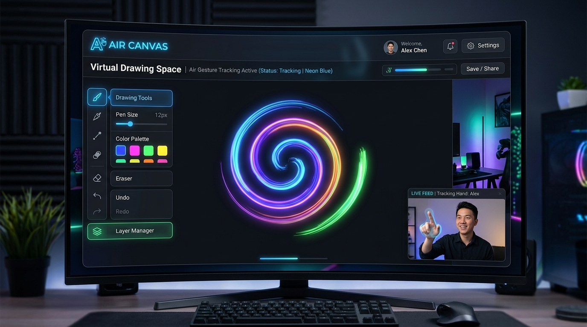

# Devika Shetty - Developer Portfolio

A sleek, responsive single-page personal developer portfolio built with modern Web Standards (HTML5, CSS3 Custom Properties, Vanilla JavaScript, and Micro-Animations).



---

## 📁 Directory Structure

```text
devika-portfolio/
│
├── index.html                  # Main single-page HTML
├── resume.pdf                  # Downloadable PDF Resume
├── favicon.ico                 # Browser Tab Icon
│
├── assets/
│   ├── images/
│   │   ├── profile.jpg         # Profile Portrait Photo
│   │   ├── hero-bg.svg         # Hero Background Vector Grid
│   │   ├── projects/
│   │   │   ├── air-canvas.png  # Air Canvas Project Preview
│   │   │   ├── smart-parking.png # Smart Parking Telemetry Preview
│   │   │   └── github-proj.png   # GitPulse Developer Analytics Preview
│   │   └── icons/
│   │       ├── github.svg      # GitHub Vector Icon
│   │       ├── linkedin.svg    # LinkedIn Vector Icon
│   │       ├── email.svg       # Email Vector Icon
│   │       └── external-link.svg # External Link Icon
│   │
│   └── fonts/                  # Self-hosted / Web font resources
│
├── css/
│   ├── style.css               # Main Stylesheet (Layout, UI Cards, Modals)
│   ├── variables.css           # Design Tokens & Light/Dark Theme Props
│   ├── animations.css          # Keyframes & Intersection Observer Reveal
│   └── responsive.css          # Breakpoints (Mobile, Tablet, Desktop)
│
├── js/
│   ├── main.js                 # Core DOM Interactivity, Mobile Nav, Modals, Forms
│   ├── typing-effect.js        # Dynamic Hero Typing Subtitle Animation
│   ├── scroll-animations.js    # IntersectionObserver Scroll Reveals & Skill Bars
│   └── theme-toggle.js         # Dark / Light Mode Persistence State
│
├── .gitignore                  # Git Ignore configuration
├── README.md                   # Project Documentation
└── package.json                # Project Metadata & Development Server Scripts
```

---

## ✨ Features

- 🎨 **Rich Glassmorphism & Dark/Light Themes**: Built using CSS custom properties with automatic system preference detection and localStorage theme persistence.
- ⚡ **Dynamic Hero Typing Animation**: Smooth auto-typing and backspacing text in the hero section.
- 📜 **Intersection Observer Scroll Reveals**: Staggered scroll animations and progress bar fill effects on scroll.
- 📱 **Fully Responsive Layout**: Flexbox & CSS Grid structure optimized across mobile, tablet, and widescreen displays.
- 🚀 **Interactive Project Details Modal**: Clickable project preview cards opening responsive modal windows.
- ✉️ **Functional Contact Form with Toast**: Real-time validation and animated toast notification on form submit.

---

## 🛠️ How to Run Locally

You can open `index.html` directly in any web browser, or launch a dev server using Node.js:

```bash
# Start dev server with live reload
npm run dev
```

Or view directly by opening `index.html` in your favorite browser.
